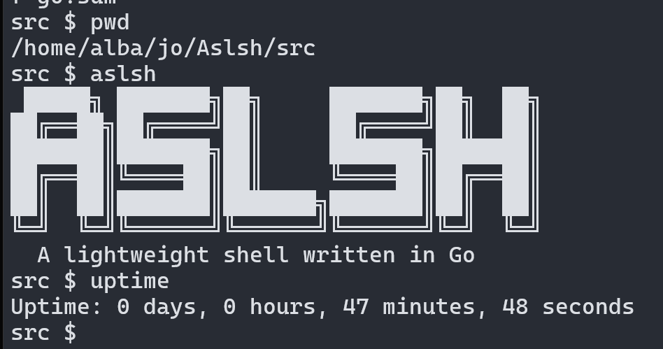
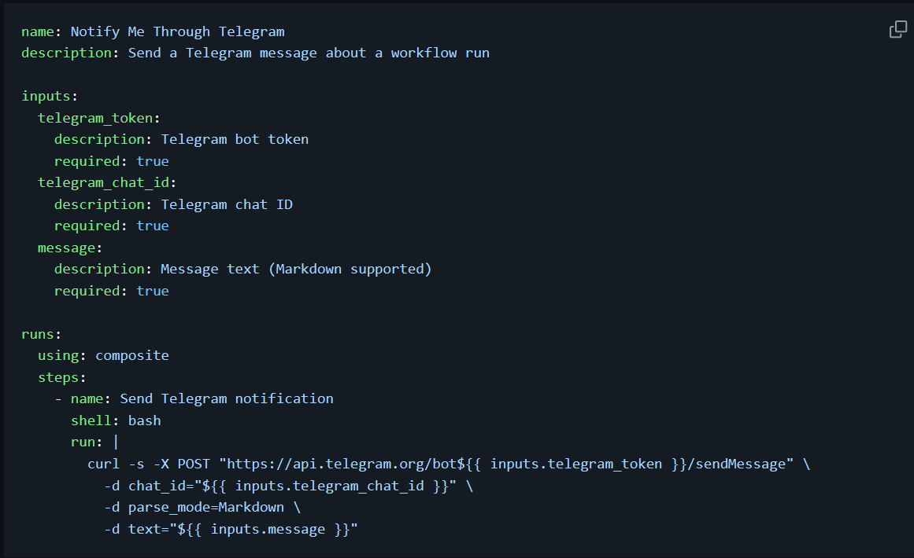

# Projects

  <strong>
    <a href="https://github.com/Snr1s3/Aslsh" style="color:#bb86fc;">Aslsh</a>
  </strong>
  
   
Aslsh is a lightweight shell implemented in Go, made for educational purposes to help me understand basic shell functionality and system command execution.

  <strong>
    <a href="https://github.com/Snr1s3/FlightsASL" style="color:#bb86fc;">FlightsASL</a>
  </strong>
  
   
FastAPI + PostgreSQL service that integrates FlightRadar24 to search airports, ingest and filter arrivals/departures, persist schedules, and serve both REST APIs and Jinja-powered web pages.

  <strong>
    <a href="https://github.com/Snr1s3/Hyprland-Rice" style="color:#bb86fc;">Hyprland-Rice</a>
  </strong>
  
   

  <strong>
    <a href="https://github.com/Snr1s3/notify-telegram-action" style="color:#bb86fc;">notify-telegram-action</a>
  </strong>
  
   
This GitHub Actions workflow sends a detailed Telegram notification whenever a workflow (such as your tests) finishes running. The notification includes the repository name, commit message, author, workflow name, and the final status (success or failure), helping you easily monitor your project's CI/CD results in real time.

  <strong>
    <a href="https://github.com/Snr1s3/upload-to-docker-action" style="color:#bb86fc;">upload-to-docker-action</a>
  </strong>
  
   

---
